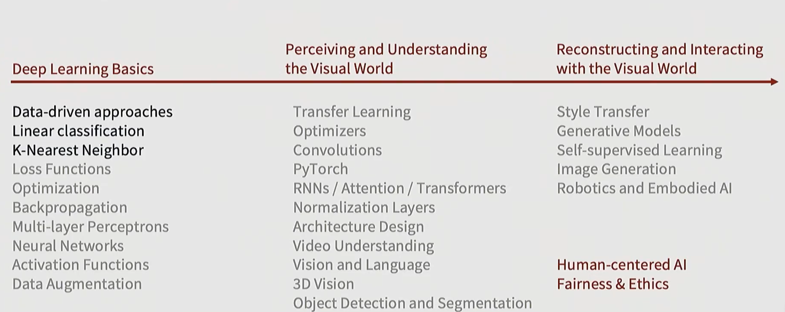
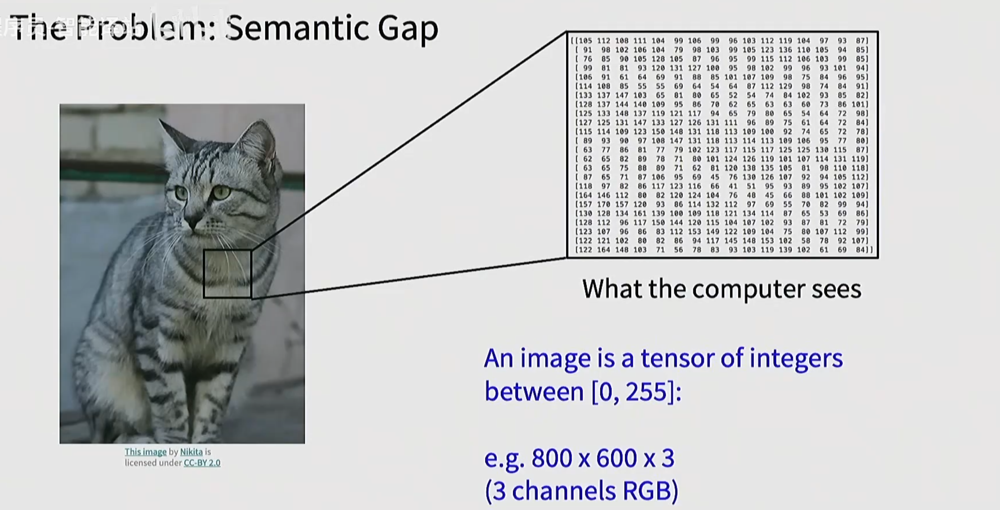

+++
date = 2026-09-26
draft = false
title = 'cs231n课程学习笔记-01 线性分类器与图像分类'
summary = '深度学习基础。'
authors = ['vestina']
showDate = true
showReadingTime = true
showSummary = true
series = ['cs231n课程学习笔记']
series_order = 1
categories = ['学习笔记']
tags = ['DeepLearning', 'Computer-vision', 'tutorial']
+++

## 课程大纲

## 图像分类
图像分类是计算机视觉中的核心任务，也是一个非常好的基准。

图像通常由数据张量来定义，一般由 长x宽x3 组成。（3是由于彩色图像一般有RGB三个通道，分别代表红、绿、蓝）

图像分类有许多挑战，例如摄像机位置移动、光照、背景杂乱、遮挡。每个RGB像素值是表面材质颜色和光源的函数。我们在图像识别中通常会归一化图像尺寸，所以分辨率的影响没那么大。