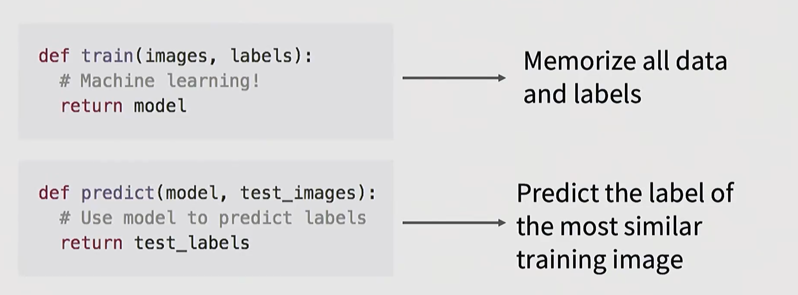
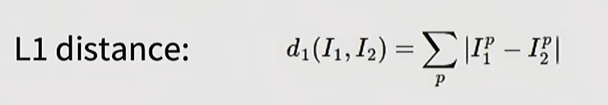

+++
date = 2026-09-26
draft = false
title = 'cs231n课程学习笔记-01 线性分类器与图像分类'
summary = '深度学习基础。'
authors = ['vestina']
showDate = true
showReadingTime = true
showSummary = true
series = ['cs231n课程学习笔记']
series_order = 1
categories = ['学习笔记']
tags = ['DeepLearning', 'Computer-vision', 'tutorial']
+++

## 1.课程大纲


## 2.图像分类
图像分类是计算机视觉中的核心任务，也是一个非常好的基准。

图像通常由数据张量来定义，一般由 长x宽x3 组成。（3是由于彩色图像一般有RGB三个通道，分别代表红、绿、蓝）


图像分类有许多挑战，例如摄像机位置移动、光照、背景杂乱、遮挡。每个RGB像素值是表面材质颜色和光源的函数。我们在图像识别中通常会归一化图像尺寸，所以分辨率的影响没那么大。

### 2.1 机器学习：数据驱动
1. 收集图像及其标签的数据集
2. 使用机器学习算法去训练一个分类器：构建一个训练函数，接受训练数据中的图像以及标签，构建一个能够将图像与标签联系起来的模型。
3. 在新图像上评估分类器

### 2.2 nearest neighbor classifier
需要train和predict函数

predict函数会找到和新输入的图像最相似的图像，并输出它的标签

为此，需要一个距离函数，接收两个图像，将训练图像中的每一个与查询图像进行比较，并返回一个值，which定义了两者之间的相似度。

有许多方法，其中最流行的有L1距离：所有像素差绝对值的总和。


nearest neighbor classifier代码实现：
```python
import numpy as np

class NearestNeighbor:
    def __init__(self):
        pass

    def train(self,X,y):
        """X is N x D where each row is an example. Y is 1-dimension of size N.D是每个样本的特征维度，y[i]是第i个训练样本的类别标签。"""
        # the nearest neighbor classifier simply remembers all the training data.没有真正地训练，只是单纯地记忆
        self.Xtr = X
        self.ytr =y
    
    def predict(self,X):
        """X is N x D where each row is an example we wish to predict label for """
        num_test = X.shape[0] #返回测试样本数量N
        # lets make sure that the output type matches the input type
        Ypred = np.zeros(num_test,dtype=self.ytr.dtype)

        #loop over all test rows
        for i in range(num_test):
            #find the nearest training image to the i'th test image
            #using the l1 distance
            distances = np.sum(np.abs(self.Xtr - X[i,:]),axis = 1)
            #X[i,:]表示取X的i行所有列，该式子会使每个训练样本都减去当前测试样本，然后取绝对值，再按行取和
            min_index = np.argmin(distances)
            Ypred[i] = self.ytr[min_index]

        return Ypred
```

对于train：O(1)，对于predict：O(n)
只能用于简单的数据，因为我们希望预测时很快，在训练的时候多花一点时间。

